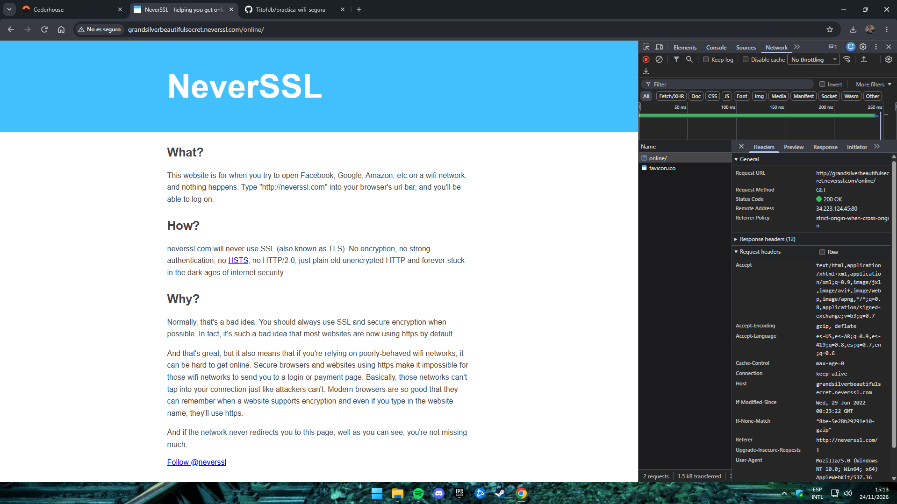

# Informe de Auditoría de Red Wi-Fi Insegura

**Práctica:** Seguridad en el aire: cómo sobrevivir a una Wi-Fi pública
**Rol:** Auditor de seguridad junior
**Autor/a:** Iván Piffer
**Fecha:** 24/11/2026

---

## 1. Introducción

Cuando nos conectamos a una red Wi-Fi pública (cafetería, aeropuerto, hotel) compartimos el medio de transmisión con decenas de desconocidos. Si el tráfico que enviamos no está cifrado, cualquier persona conectada a la misma red puede capturarlo con herramientas de análisis de paquetes como Wireshark (*sniffing*).

El objetivo de este informe es:

- Comprender la diferencia entre **HTTP** y **HTTPS**.
- Identificar qué información queda expuesta durante una conexión HTTP.
- Explicar cómo una **VPN** protege el tráfico en una red pública.
- Proponer recomendaciones de uso seguro.

Para ello se analizó una solicitud real hecha desde el navegador a un sitio que funciona deliberadamente **sin cifrado**, usando las herramientas de desarrollador (F12 → pestaña *Network*).

---

## 2. Sitio analizado

| Dato | Valor |
|---|---|
| **Sitio** | `http://neverssl.com` |
| **Host** | `neverssl.com` |
| **Esquema** | `http://` (sin cifrado) |
| **Herramienta** | DevTools del navegador (F12 → *Network*) |
| **Procedimiento** | Se ingresó al sitio, se abrió *Network*, se recargó la página y se seleccionó la primera solicitud |

`neverssl.com` es un sitio creado a propósito para funcionar solo por HTTP. Se usa, por ejemplo, para forzar la aparición de los portales cautivos de las Wi-Fi públicas. Por eso es un buen caso de estudio para ver cómo viaja la información "a la vista".

---

## 3. Evidencia observada

Datos de la primera solicitud (pestaña *Network* → *Headers*):

| Campo | Valor observado |
|---|---|
| **URL solicitada** | `http://neverssl.com/` |
| **Método HTTP** | `GET` |
| **Host** | `neverssl.com` |
| **Protocolo** | HTTP/1.1 sobre `http://` (no HTTPS) |
| **Código de estado** | `200 OK` |

**Headers de la solicitud enviados por el navegador** (ejemplo; los valores exactos dependen del navegador y del sistema):

```http
GET / HTTP/1.1
Host: neverssl.com
User-Agent: [completar con tu User-Agent real, ej. Mozilla/5.0 (...) Chrome/...]
Accept: text/html,application/xhtml+xml,application/xml;q=0.9,*/*;q=0.8
Accept-Language: es-AR,es;q=0.9
Accept-Encoding: gzip, deflate
Connection: keep-alive
```

> 📸 **Captura de pantalla:** 
> *(Agregar la captura al repositorio con el nombre `captura-network.png`.)*

**Observación clave:** el navegador no muestra ningún candado y el esquema es `http://`. Todo lo listado arriba viaja como **texto plano** por la red.

---

## 4. Riesgos encontrados

### 4.1 ¿Qué protocolo utiliza el sitio?

Utiliza **HTTP**, no HTTPS. Esto significa que la comunicación entre el navegador y el servidor **no está cifrada**: no hay TLS que proteja el contenido.

Analogía: HTTP es como una **postal escrita a mano**, cualquiera que la manipule en el camino puede leerla. HTTPS es como una **caja fuerte cerrada con llave** que viaja por el correo.

### 4.2 ¿Qué información puede observarse durante la solicitud?

Al menos los siguientes elementos son visibles en texto plano:

1. **Host y URL completa** (`neverssl.com` y la ruta pedida): revela qué sitio y qué página se visita.
2. **Método HTTP** (`GET`): revela qué acción se está realizando.
3. **Headers**, entre ellos:
   - **User-Agent:** navegador, versión y sistema operativo del dispositivo.
   - **Accept-Language:** idioma y, a veces, región del usuario.
   - **Cookie** (si existiera): puede contener identificadores de sesión.
4. **Contenido de la respuesta** (HTML, imágenes, formularios), también sin cifrar.

### 4.3 Riesgos de navegar por HTTP desde una Wi-Fi pública

Un atacante conectado a la misma red puede:

- **Espiar (sniffing):** capturar paquetes con Wireshark y leer sitios visitados, páginas, headers y contenido.
- **Robar credenciales:** si un formulario de login se envía por HTTP, usuario y contraseña viajan en texto plano.
- **Secuestrar sesiones (session hijacking):** robar cookies de sesión y entrar a una cuenta ya abierta sin conocer la contraseña.
- **Perfilar al usuario:** reconstruir hábitos de navegación, intereses y datos del dispositivo (User-Agent).
- **Modificar el contenido (Man-in-the-Middle):** alterar páginas en tránsito, inyectar publicidad o *malware*, o redirigir a sitios falsos.
- **Engañar con redes falsas (Evil Twin):** una red como `Starbucks_Gratis` creada por el atacante hace que todo el tráfico pase primero por su equipo.

**Aclaración sobre mitos comunes:**

- *"Si tiene contraseña, es segura"*: falso. Si la clave se entrega a todos los clientes, todos tienen la "llave" y pueden intentar ataques internos.
- *"Solo me hackean si descargo algo"*: falso. Navegar por sitios inseguros ya puede exponer identidad, hábitos y sesiones abiertas.

---

## 5. Cómo ayuda una VPN

Una **VPN (Red Privada Virtual)** crea un **túnel seguro** entre el dispositivo y un servidor VPN, dentro de la red pública.

| Aspecto | Cómo actúa la VPN |
|---|---|
| **Cifrado** | El tráfico se **cifra** antes de salir del dispositivo. Un atacante que lo capture solo verá datos ilegibles ("ruido cifrado"). |
| **Túnel seguro / encapsulamiento** | Los paquetes originales se **encapsulan** dentro de otros paquetes cifrados que viajan por el **túnel** hasta el servidor VPN. Desde afuera solo se ve tráfico hacia el servidor VPN, no los sitios reales ni su contenido. |
| **Protección del tráfico** | Aunque el sitio use HTTP, la parte del trayecto entre el dispositivo y el servidor VPN (la red Wi-Fi pública) queda protegida contra sniffing y manipulación. |
| **Privacidad** | El operador de la Wi-Fi y otros usuarios no pueden ver qué sitios se visitan. Además, el sitio de destino ve la IP del servidor VPN y no la de la red pública. |

**Limitaciones importantes:**

- La VPN protege el tramo hasta el servidor VPN. Desde ahí hasta el sitio, un sitio HTTP sigue sin estar cifrado.
- Por eso **VPN + HTTPS** es la combinación recomendada.
- Hay que confiar en el proveedor de la VPN, ya que este pasa a ver el tráfico de metadatos.

---

## 6. 3 Reglas de Oro para navegar en redes Wi-Fi públicas

1. **Usar siempre HTTPS (verificar el candado) y evitar sitios HTTP.**
   No ingresar contraseñas, datos bancarios ni información personal en páginas sin cifrado.

2. **Activar una VPN confiable antes de usar la red.**
   Así el tráfico viaja cifrado dentro de un túnel aunque la red sea hostil.

3. **Verificar la red y reducir la exposición.**
   Confirmar el nombre exacto de la red con el personal del local (para evitar *Evil Twins*), desactivar la conexión automática a redes abiertas, desactivar el uso compartido de archivos y no realizar operaciones sensibles (home banking, compras) en Wi-Fi pública si se puede evitar.

---

## 7. Conclusión

El análisis de una simple solicitud a `http://neverssl.com` muestra que en HTTP el host, la URL, el método y los headers circulan en texto plano. En una Wi-Fi pública, esto permite espiar, perfilar y hasta manipular la conexión. La combinación de **HTTPS + VPN + buenos hábitos** reduce de forma importante estos riesgos.
